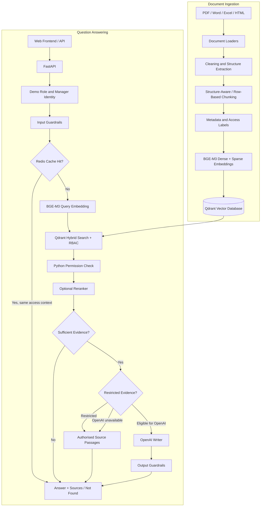
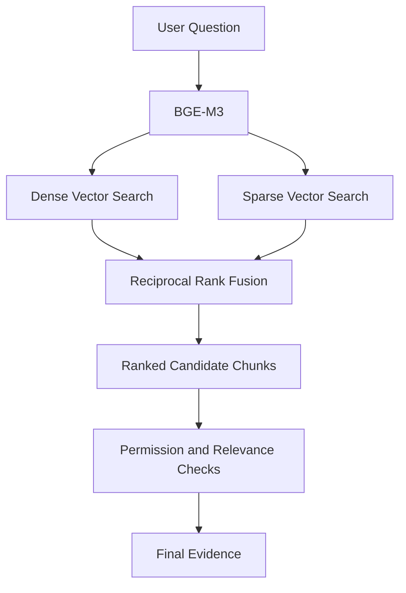
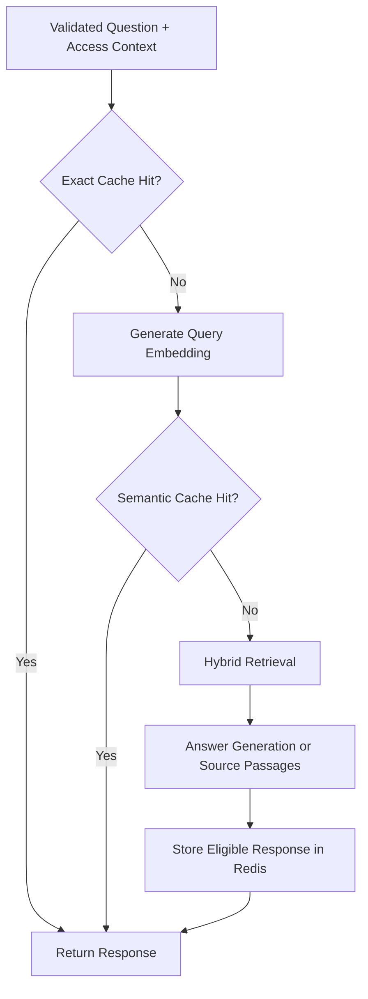

# SwiftPay Enterprise Knowledge Assistant (RAG)

**Enterprise Retrieval-Augmented Generation with Hybrid Search, Role-Based Access Control, Guardrails, Redis Caching and Source Citations**

**Repository:** https://github.com/macklae/swiftpay-rag  
**Backend:** Python and FastAPI  
**Embedding Model:** BGE-M3  
**Vector Database:** Qdrant  
**Caching:** Redis  
**LLM:** OpenAI  
**Status:** Locally implemented, tested and published to a public GitHub repository. The application has not yet been deployed to a production environment.

---

# Project Overview

SwiftPay Enterprise RAG is an AI-powered knowledge assistant that answers questions using enterprise documents.

It retrieves relevant information from approved documents and provides answers with source references, including document names, sections and pages where available.

If sufficient evidence cannot be found, the system returns **"Not found"** rather than inventing an answer.

The system also enforces document-level, section-level and team-level permissions so that users only receive information appropriate to their access context.

The project follows nine standard AI/ML lifecycle stages:

1. Business Understanding
2. Collecting Data
3. Understanding Data
4. Data Preparation or Cleansing
5. Model Building
6. Model Training
7. Model Testing
8. Model Evaluation
9. Deployment

Unlike traditional machine-learning projects, this RAG application does not train a new foundation model. It uses pretrained embedding, reranking and language models.

The work involved building the retrieval architecture, preparing the data, integrating models, implementing security controls, testing, evaluating and deploying the application locally.

---

# Technology Stack and Tools

| Technology / Tool | Purpose | Why Selected |
|---|---|---|
| Python 3.11 | Backend development | NLP and AI ecosystem |
| VS Code | Development environment | Code editing and debugging |
| uv | Python environment management | Efficient environment and dependency workflow |
| pip / requirements.txt | Dependency installation | Standard Python installation |
| Docker Desktop | Container infrastructure | Run supporting services locally |
| Docker Compose | Infrastructure orchestration | Start Qdrant and Redis together |
| FastAPI | Backend API | Lightweight asynchronous web framework |
| Uvicorn | Application server | Serve FastAPI |
| HTML | Frontend structure | Browser-based interface |
| CSS | Frontend styling | User interface presentation |
| JavaScript | Frontend interaction | API calls and ingestion progress |
| BGE-M3 | Embedding model | Dense and sparse retrieval |
| BGE Reranker v2 M3 | Optional reranking | Reorder retrieved passages |
| Qdrant | Vector database | Hybrid search and metadata filtering |
| Redis | Cache database | Exact and semantic caching |
| OpenAI API | Answer generation | Generate answers from retrieved evidence |
| LibreOffice | DOCX-to-PDF conversion | Page citations for Word documents |
| Python unittest | Automated testing | Functional and security tests |
| Custom evaluation scripts | Retrieval and answer evaluation | Measure quality and latency |
| Git | Version control | Track project changes |
| GitHub | Source repository | Private code hosting |
| GitHub CLI | Repository publication | Create and push GitHub repository |

The cache uses custom Redis code and works with plain Redis. **RedisVL is not used.**

The authoritative list of Python packages and versions is in `requirements.txt`.

---

# System Architecture

## High-Level Architecture



The diagram shows the logical processing flow. The application code determines the precise handling of cache eligibility, errors and responses.

## Why This Architecture?

The application separates document ingestion from question answering.

**Ingestion** prepares and indexes documents. **Retrieval** locates evidence. **Generation** converts authorised evidence into a readable answer.

This design allows documents to be updated without retraining an LLM.

It also allows retrieval, access control, caching and generation to be tested independently.

---

# Stage 1 — Business Understanding

## 1.1 Business Problem

Enterprise information is stored across different formats and locations.

Employees may need to search multiple policies, operational procedures, reports and spreadsheets to answer one question.

This creates several problems:

- Slow information discovery.
- Inconsistent answers.
- Reliance on employee memory.
- Difficulty identifying authoritative information.
- Incorrect interpretation of business policies.
- Exposure of confidential information.
- Repeated manual effort.

A traditional keyword search may locate a document without identifying the exact information required.

A general-purpose LLM does not automatically know SwiftPay's private documents.

## 1.2 Business Objective

Build an enterprise knowledge assistant that:

1. Accepts natural-language questions.
2. Searches approved SwiftPay documents.
3. Retrieves relevant evidence.
4. Applies role-based permissions.
5. Generates grounded answers.
6. Displays supporting sources.
7. Returns "Not found" when evidence is insufficient.
8. Caches responses to improve performance.

## 1.3 Why RAG?

RAG stands for Retrieval-Augmented Generation.

It combines information retrieval with a generative language model.

```text
User Question
     |
     v
Retrieve Relevant Documents
     |
     v
Select Authorised Evidence
     |
     v
LLM Generates Answer
     |
     v
Answer + Source Citations
```

Unlike fine-tuning, RAG does not require model weights to be updated whenever a document changes.

RAG reduces the risk of unsupported answers but cannot guarantee that hallucinations will never occur.

## 1.4 Success Criteria

| Objective | Measurement |
|---|---|
| Correct answers | Golden question evaluation |
| Relevant retrieval | Precision@5, Recall@5, Hit@5 and MRR |
| Accurate citations | Source validation |
| Appropriate abstention | Not-found tests |
| Secure access | RBAC tests |
| Cache correctness | Isolation and reuse tests |
| Faster repeated questions | Latency benchmarks |
| Maintainability | Automated tests |

## 1.5 Limitations

The initial dataset is small and curated.

Successful evaluation on this dataset does not establish production-level performance across a large enterprise document collection.

---

# Stage 2 — Collecting Data

## 2.1 Data Sources

The project uses eight documents across five formats.

| Document | Format | Information |
|---|---|---|
| SOP-OPS-001 Incident Management and Escalation | PDF | Incident procedures and escalation |
| SOP-OPS-005 Database Backup and Restore | PDF | Backup and recovery procedures |
| POL-HR-010 Leave, Travel and Expense Policy | DOCX | HR policies |
| Monthly IT Operations Report — September 2026 | DOCX | Operational reports and restricted roster |
| Service Catalogue and Ownership | XLSX | Services, teams and ownership |
| Employee Training Records | XLS | Employee training records |
| TimesFM-3 Interactive Guide | HTML | External AI-model information |
| Kimi K3 Model Report | HTML | External AI-model information |

Dataset composition:

| Format | Count |
|---|---:|
| PDF | 2 |
| DOCX | 2 |
| XLSX | 1 |
| XLS | 1 |
| HTML | 2 |
| **Total** | **8** |

## 2.2 Why Multiple Formats?

Enterprise information is not stored exclusively in PDFs.

Different formats require different extraction methods.

PDFs contain pages and structured text.

Word documents contain headings, paragraphs, tables and appendices.

Excel files contain sheets, rows, columns and numerical values.

HTML documents contain useful content alongside navigation menus, scripts and styles.

Using multiple formats tests whether the ingestion pipeline can preserve the meaning of information regardless of its original representation.

## 2.3 Why Include Unrelated HTML Documents?

The TimesFM-3 and Kimi K3 pages are unrelated to SwiftPay's internal operational policies.

They were included to test whether the assistant can distinguish between relevant evidence and misleading contextual similarities.

For example:

**Question:** What is TimesFM-3?

The assistant may answer using the TimesFM-3 document.

**Question:** Which forecasting model does SwiftPay use?

The existence of the TimesFM-3 document does not establish that SwiftPay uses it.

The assistant should not invent such a relationship.

## 2.4 Data Security

The documents contain different access classifications:

- Internal
- Confidential
- Restricted

Some documents contain sections with different permissions.

For example, the Monthly IT Operations Report contains a restricted on-call roster in Appendix B.

The system therefore needs chunk-level access metadata rather than relying exclusively on document-level classification.

## 2.5 Limitations

The source documents are stored locally in `data/documents/` and excluded from GitHub.

A fresh clone requires authorised access to the documents before rebuilding the original index.

The project does not demonstrate automatic ingestion from live enterprise document-management systems.

---

# Stage 3 — Understanding Data

## 3.1 Data Exploration

Before ingestion, the documents were examined to understand:

- File structure.
- Headings and sections.
- Tables.
- Spreadsheet rows and columns.
- Document versions.
- Access classifications.
- Sensitive information.
- Conflicting information.
- Missing referenced documents.

## 3.2 Importance of Table Structure

Consider:

| Severity | Acknowledgement |
|---|---|
| P1 | 5 minutes |
| P2 | 15 minutes |

If only the values are extracted:

```text
5 minutes
15 minutes
```

the information loses its meaning.

A better representation is:

```text
Severity: P1
Acknowledgement: 5 minutes
```

This is why the ingestion pipeline preserves table headers and associated values.

## 3.3 Conflicting Documents

Some documents contain different information about related business rules.

For example:

**Database Backup SOP**

- Payments database RPO: 15 minutes.
- Payments database RTO: 1 hour.

**Service Catalogue**

- Tier 0 RPO: 5 minutes.
- Tier 0 RTO: 30 minutes.

These figures refer to different contexts.

The documented interpretation is to use the database SOP for database-specific backup questions and the service catalogue for general service-tier questions.

The source should always be cited.

Other identified ambiguities include differences in Head of SRE names, expense claim deadlines and document version references.

## 3.4 Indexed Dataset

The recorded local ingestion produced:

**151 indexed chunks from eight documents.**

One document can produce several chunks depending on its structure.

The chunk count may change if ingestion settings or source documents change.

## 3.5 Limitations

Document analysis identifies inconsistencies but cannot automatically determine which business rule is authoritative.

Where source documents conflict, human confirmation may be required.

---

# Stage 4 — Data Preparation or Cleansing

## 4.1 Objective

Transform source documents into structured, searchable chunks while preserving meaning, provenance and permissions.

The ingestion pipeline is implemented under:

```text
app/ingestion/
```

## 4.2 Ingestion Components

| Module | Responsibility |
|---|---|
| `loaders_pdf.py` | PDF extraction |
| `loaders_docx.py` | Word extraction |
| `loaders_excel.py` | Excel extraction |
| `loaders_html.py` | HTML extraction |
| `loaders_text.py` | Text extraction |
| `convert.py` | Document conversion |
| `text_utils.py` | Text-processing utilities |
| `chunking.py` | Chunk construction |
| `policy.py` | Ingestion policies |
| `pipeline.py` | Ingestion orchestration |

## 4.3 Cleaning Operations

The pipeline prepares documents by:

1. Extracting meaningful content.
2. Preserving headings and tables.
3. Removing HTML navigation, scripts and styles.
4. Handling sensitive fields according to ingestion policy.
5. Preserving meaningful blank spreadsheet cells.
6. Reading available saved spreadsheet formula values.
7. Adding source and permission metadata.
8. Creating chunks.
9. Generating embeddings.
10. Indexing the results in Qdrant.

## 4.4 Implemented Chunking Strategy

The project uses different chunking methods depending on document structure.

| Route | Document Types | Implemented Method |
|---|---|---|
| A | PDF, Word | Structure-aware chunking |
| B | Excel | Row-based chunking |
| C | HTML | Heading-based chunking after cleaning |
| Fallback | Long paragraphs or sections | Recursive splitting with overlap |

### Route A — PDF and Word

The main approach is structure-aware chunking.

A section becomes a chunk where practical.

Tables remain associated with their headers and introductory sentences.

Long tables are divided by rows, with header information repeated.

**Why?**

This preserves the relationship between operational rules, headings, numerical values and explanations.

### Route B — Excel

The pipeline uses row-based chunking.

Each substantive row is represented as labelled facts.

Example:

```text
Service: payments-service
Tier: Tier 0
Owner: Payments Platform
```

Small reference sheets such as About, Teams, Tiers and Summary may be represented as one chunk per sheet.

**Why?**

Spreadsheet values require column names to retain their meaning.

### Route C — HTML

HTML pages are cleaned to remove navigation menus, scripts and styles.

The remaining content is split around headings.

**Why?**

Web pages contain substantial non-content material that can introduce noise into embeddings.

### Fallback — Recursive Splitting

Long sections or paragraphs are split recursively at paragraph, line and sentence boundaries, with a small overlap.

**Why?**

This avoids oversized chunks while preserving more context than arbitrary fixed-length splitting.

## 4.5 Word Page Numbers

Word documents do not have universally fixed page numbers independent of rendering.

The project supports conversion to PDF using LibreOffice.

On macOS:

```bash
brew install --cask libreoffice
```

When conversion is unavailable, the application cites Word documents by section rather than inventing page numbers.

## 4.6 Chunk Metadata

Each chunk carries a label card containing relevant information such as:

- Document name.
- Document version.
- Section.
- Page or sheet and row.
- Classification.
- Allowed roles.
- Team.

Metadata supports retrieval filtering and source attribution.

## 4.7 Why Not Use Only Fixed-Size Chunking?

Fixed-size chunking can separate headings from the content they describe.

It can also split table headers from numerical values.

Structure-aware chunking better preserves the relationships needed to answer business questions.

The initial proposal considered chunks of approximately 300–500 tokens as a starting target, not a guarantee that every chunk has that exact size.

## 4.8 Limitations

Complex PDF layouts, scanned documents, merged spreadsheet cells and unusual formatting can still cause extraction problems.

Chunking also introduces a trade-off between precision and preserving context.

---

# Stage 5 — Model Building

## 5.1 Objective

Integrate the components required for a complete RAG application:

- Embeddings.
- Vector database.
- Hybrid retrieval.
- Role-based access control.
- Optional reranking.
- LLM generation.
- Guardrails.
- Caching.
- FastAPI.
- Frontend.

## 5.2 BGE-M3 Embeddings

The selected model is:

```text
BAAI/bge-m3
```

BGE-M3 generates dense and sparse representations.

The dense embedding dimension is 1024.

### Dense Embeddings

Dense embeddings represent semantic meaning.

For example:

```text
How quickly should a critical incident be acknowledged?
```

may retrieve content about:

```text
P1 incident acknowledgement requirements
```

even when the wording differs.

### Sparse Embeddings

Sparse representations support lexical matching of important terms and identifiers.

Examples:

```text
SOP-OPS-001
P1
RPO
RTO
payments-service
```

### Why BGE-M3?

BGE-M3 provides both dense and sparse retrieval signals.

This reduces the need to integrate a separate keyword model.

### Limitation

Semantic similarity does not guarantee factual relevance.

Related passages may be retrieved even when they do not directly answer the question.

## 5.3 Qdrant Vector Database

Qdrant stores indexed chunks and their vector representations.

The application uses:

```text
app/vectorstore.py
```

Qdrant supports:

- Dense vector search.
- Sparse vector search.
- Metadata filtering.
- Hybrid retrieval.
- Persistent indexed records.

### Why Qdrant?

Qdrant supports the project's combined requirements for vector retrieval and metadata-based access filtering.

It can also run locally using Docker.

Alternatives considered included pgvector, Weaviate, Milvus, Chroma and FAISS.

These alternatives were not exhaustively benchmarked against Qdrant.

## 5.4 Hybrid Retrieval

The application combines dense and sparse retrieval using Reciprocal Rank Fusion.



RRF combines ranking positions instead of directly combining incompatible raw similarity scores.

\[
RRF(d)=\sum_i\frac{1}{k+r_i(d)}
\]

Where \(r_i(d)\) is the rank of chunk \(d\) in retrieval list \(i\).

The recorded retrieval configuration used an initial pool of approximately 20 candidates and final evidence selection of approximately five chunks.

Actual settings are controlled by the application configuration.

## 5.5 Optional Reranking

The optional reranker is:

```text
BAAI/bge-reranker-v2-m3
```

It evaluates question-passage pairs and reorders candidate chunks.

Reranking was implemented and tested but remains disabled in the selected configuration.

The experiment improved MRR but did not improve the measured Precision@5 or Hit@5.

Its additional latency was not benchmarked.

## 5.6 Authentication and Permissions

### Important: Demo Identity

The application uses a demo identity mechanism.

The browser sends a selected role and, for Line Managers, a manager name.

**This is not production-grade authentication.**

Selecting a role in the interface does not prove the user's identity.

Before production deployment, the application requires verified authentication and server-side authorisation.

### Supported Roles

| Role Identifier | Role |
|---|---|
| `employee` | Employee |
| `line_manager` | Line Manager |
| `hr_ld` | HR / Learning and Development |
| `sre_ops` | SRE / Operations |

### Permission Rules

| Content | Access |
|---|---|
| Internal SOPs, HR policy, service catalogue and sample HTML | All roles |
| Confidential Operations Report | Line Manager and SRE / Operations |
| Restricted Appendix B on-call roster | SRE / Operations |
| Restricted Training Records | HR / L&D: all permitted records; Line Manager: own team; Employee: none |

Line-manager access depends on the manager identity associated with training records.

Two managers must not be able to retrieve each other's team information.

### Permission Enforcement

The application applies multiple checks.

**First: Qdrant filtering**

Permission conditions are applied during vector search.

**Second: Python verification**

Returned chunks undergo an additional application-level permission check.

**Third: Restricted-content handling**

Restricted evidence is not sent to OpenAI.

Authorised restricted content is returned as found source text instead.

**Fourth: Cache isolation**

Cached answers are scoped to access context, including role and manager identity.

**Fifth: Document management**

Upload and delete operations are limited to HR / L&D and SRE / Operations roles in the demo workflow.

### Why Multiple Checks?

Applying permissions only after an LLM call would be too late to prevent sensitive evidence from reaching the external provider.

Multiple checks reduce reliance on a single enforcement point.

### Limitations

The demo role selector must be replaced with verified enterprise identity.

Production deployment also requires testing against forged role claims, direct API requests and access changes.

## 5.7 Detailed Guardrails

Guardrails are implemented primarily in:

```text
app/guardrails.py
```

The application uses input, retrieval and output safeguards.

### Input Guardrails

| Guardrail | Implementation Purpose |
|---|---|
| Empty input check | Reject empty questions |
| Length validation | Prevent excessively large inputs |
| Control-character removal | Normalise potentially disruptive characters |
| Prompt-injection pattern checks | Block recognised malicious instruction patterns |
| Phone-number masking | Reduce personal-data exposure |
| Payment-card masking | Detect card-like numbers using a Luhn check before masking |
| Aadhaar masking | Protect Indian identity numbers |
| PAN masking | Protect Indian tax identifiers |
| API-key masking | Reduce accidental credential exposure |

Sensitive patterns are masked before the question is cached, embedded or sent onward.

### Why Input Guardrails?

User input may contain personal information, credentials or malicious instructions.

Input checks reduce the chance that this information propagates into retrieval, caching or external model calls.

### Retrieval Guardrails

| Guardrail | Implementation Purpose |
|---|---|
| Qdrant permission filter | Restrict retrieved evidence |
| Secondary Python permission check | Defence in depth |
| Relevance threshold | Reject insufficient evidence |
| Instruction-like line removal | Reduce prompt injection from retrieved documents |
| Restricted-content handling | Prevent restricted passages reaching OpenAI |
| Missing-document handling | Identify referenced documents absent from the knowledge base |

The relevance floor is configurable using `MIN_DENSE_SCORE`.

When retrieved evidence is below the required threshold, the system returns "Not found".

The threshold is an initial tuning value, not a calibrated probability that an answer is correct.

### Output Guardrails

| Guardrail | Implementation Purpose |
|---|---|
| Citation validation | Require citations to actual retrieved sources |
| Unsupported-answer handling | Replace answers without valid supporting sources with "Not found" |
| Numerical grounding | Check whether numerical claims appear in cited evidence |
| Personal-data masking | Reduce sensitive output exposure |
| System-prompt canary check | Detect specified prompt-content leakage |
| Output length cap | Limit excessively long responses |

### API and Upload Guardrails

The application also includes:

- Rate limiting per client and role.
- Upload file-type checks.
- Upload size checks.
- Upload format validation.
- Role restrictions for upload and delete operations.

### Why Layered Guardrails?

Different risks occur at different stages.

Input validation cannot replace retrieval permissions.

Retrieval permissions cannot guarantee a generated answer is factually correct.

Output validation cannot undo sensitive information already sent to an external service.

Each layer addresses a different failure mode.

### Guardrail Limitations

Pattern-based checks cannot detect every prompt-injection attempt.

Masking may miss unusual personal-data formats.

A Luhn check does not establish that a card number is genuine or authorised.

Citation and numerical checks do not prove that the overall answer is semantically correct.

The controls require adversarial testing before production use.

## 5.8 OpenAI Integration

The writer is implemented in:

```text
app/llm.py
```

The RAG orchestration is implemented in:

```text
app/rag.py
```

The writer receives retrieved, authorised evidence and generates a readable answer.

### Why OpenAI?

Using a pretrained API model avoids the infrastructure and data requirements of training or hosting a generative LLM.

### No-Key Fallback

The application can run without an OpenAI API key.

In that case, it returns matching source passages rather than generated answers.

Restricted evidence also follows a passage-only path and is not sent to OpenAI.

### Limitations

External API calls introduce latency, cost, network dependency and data-governance considerations.

## 5.9 Redis Caching

Caching is implemented in:

```text
app/cache.py
```

The application uses custom Redis code.

**RedisVL is not used.**

### Exact Cache

An exact-cache hit allows a previously generated answer to be reused for the same normalised question and applicable access context.

This avoids repeating retrieval and generation.

### Semantic Cache

The semantic cache can reuse answers for sufficiently similar questions.

For example:

```text
How soon must a P1 incident be acknowledged?
```

and:

```text
What is the acknowledgement deadline for P1 incidents?
```

may be equivalent.

However:

```text
What is the P1 acknowledgement time?
```

and:

```text
What is the P2 acknowledgement time?
```

are similar but require different answers.

This is why conservative semantic matching is necessary.

### Cache Features

| Feature | Purpose |
|---|---|
| Exact matching | Reuse identical questions |
| Semantic matching | Reuse sufficiently similar questions |
| TTL | Expire saved answers |
| Invalidation | Remove affected cached answers when documents change |
| Role isolation | Prevent cross-role reuse |
| Manager isolation | Prevent cross-team reuse |

### Cache Flow



### Why Redis?

Redis provides low-latency storage and automatic expiration.

Caching can avoid repeated embedding, retrieval and LLM processing.

### Cache Limitations

Semantic similarity does not guarantee answer equivalence.

Cache entries may become stale when documents change.

A new document may also make an earlier "Not found" answer obsolete.

TTL alone does not solve document-change invalidation.

The cache distance threshold requires further evaluation using labelled examples of correct and incorrect reuse.

## 5.10 FastAPI Backend and Frontend

The backend is implemented in:

```text
app/api.py
```

Supporting modules include:

```text
app/auth.py
app/access.py
app/services.py
app/jobs.py
app/config.py
app/rag.py
```

The frontend consists of:

```text
frontend/index.html
frontend/app.js
frontend/styles.css
```

The frontend provides a browser-based interface for selecting a demo role, loading documents, submitting questions and viewing responses.

The backend remains responsible for retrieval, access filtering, guardrails and response generation.

Frontend role controls alone are not a security boundary.

---

# Stage 6 — Model Training

## 6.1 Important Clarification

No foundation model was trained or fine-tuned in this project.

The application uses pretrained models:

- BGE-M3.
- BGE Reranker v2 M3.
- OpenAI language model.

The project focuses on configuration, integration and evaluation.

## 6.2 What Happens During Indexing?

```text
Document Text
      |
      v
Pretrained BGE-M3
      |
      v
Dense and Sparse Embeddings
      |
      v
Qdrant
```

Generating embeddings does not update BGE-M3's learned weights.

Similarly, retrieving document evidence does not train the OpenAI model.

## 6.3 Configuration and Tuning

| Parameter | Purpose | Project Decision |
|---|---|---|
| Embedding model | Represent text | BGE-M3 |
| Dense dimensions | Vector representation | 1024 |
| Chunking | Preserve context | Structure-aware and row-based |
| Initial retrieval | Candidate coverage | Approximately 20 |
| Final evidence | Limit context | Approximately 5 |
| Reranker | Improve ordering | Tested, disabled |
| Relevance floor | Reject weak evidence | Configurable |
| Cache distance | Control semantic reuse | Configurable |
| Cache TTL | Control expiration | Configurable |

The actual runtime settings are defined in `.env` and `app/config.py`.

## 6.4 Why Not Fine-Tune?

The project contains a small document collection and limited labelled evaluation data.

Fine-tuning would require a separate training dataset with suitable positive and negative query-passage examples.

The available evidence did not establish that fine-tuning was necessary.

## 6.5 Limitations

The project does not include training loss curves, fine-tuned model checkpoints or measured improvements from supervised model training.

This stage is therefore best described as pretrained model integration and configuration.

---

# Stage 7 — Model Testing

## 7.1 Objective

Verify that the application behaves as expected across retrieval, access control, caching, guardrails, ingestion and API workflows.

## 7.2 Golden Dataset

The project includes:

```text
tests/golden_dataset.json
```

The recorded dataset contains 25 test cases:

- 22 answerable questions.
- 3 abstention or permission-related cases.

Question types include:

- Incident acknowledgement.
- Policy lookups.
- Expense limits.
- Spreadsheet ownership.
- Database recovery procedures.
- Conflicting sources.
- Restricted information.
- External HTML content.
- Missing information.

## 7.3 Automated Test Modules

| Module | Focus |
|---|---|
| `test_access.py` | Role and team access |
| `test_cache.py` | Cache behaviour and isolation |
| `test_flow.py` | RAG flow |
| `test_guardrails.py` | Input and output safeguards |
| `test_ingest_folder_security.py` | Ingestion security |
| `fakes.py` | In-memory test doubles |

## 7.4 Correct Test Command

The project's documented test runner is Python `unittest`.

```bash
python -m unittest discover -s tests -t .
```

The end-to-end test requires the eight source documents in `data/documents/`.

## 7.5 Recorded Results

The recorded local test run completed with:

```text
47 tests passed
1 warning
```

The warning related to use of a Qdrant API key over an insecure HTTP connection.

The warning did not prevent local evaluation but requires attention before production use.

## 7.6 Golden Evaluation

Run:

```bash
python -m scripts.evaluate
```

The recorded golden evaluation passed:

```text
25 / 25
```

These are encoded test assertions, not independent proof of perfect factual accuracy.

## 7.7 Security Tests

Important scenarios included:

- Preventing SRE-scoped cached answers from being reused for Employees.
- Preventing one Line Manager's team information from being returned to another Line Manager.
- Verifying restricted access behaviour.
- Testing guardrail behaviour.
- Testing ingestion security.

## 7.8 Limitations

The test set is small.

Passing tests does not establish security against malicious users or production reliability under load.

Further testing is needed for forged identities, prompt injection, large corpora and concurrent requests.

---

# Stage 8 — Model Evaluation

## 8.1 Objective

Measure retrieval quality, answer quality, latency and the value of reranking.

Evaluation scripts include:

```text
scripts/evaluate.py
scripts/evaluate_retrieval.py
scripts/evaluate_retrieval_batch.py
scripts/retrieval_metrics.py
scripts/evaluate_answer_quality.py
scripts/benchmark_latency.py
scripts/compare_reranking.py
```

## 8.2 Retrieval Metrics

### Precision@5

Measures the proportion of the first five retrieved chunks labelled relevant.

\[
Precision@5 =
\frac{\text{Relevant chunks in top 5}}{5}
\]

### Recall@5

Measures the proportion of all labelled relevant chunks retrieved in the first five.

### Hit@5

Measures whether at least one labelled relevant chunk appears in the first five.

### Mean Reciprocal Rank

Measures how early the first labelled relevant chunk appears.

\[
MRR =
\frac{1}{N}
\sum_{i=1}^{N}
\frac{1}{rank_i}
\]

## 8.3 Initial Retrieval Evaluation

An earlier section-based evaluation reported:

| Metric | Result |
|---|---:|
| Precision@5 | 0.2636 |
| Recall@5 | 0.9270 |
| MRR | 0.8341 |

These results used document-and-section-based proxy relevance labels rather than independent human review of every passage.

## 8.4 Reranking Comparison

The project compared hybrid retrieval with and without reranking using 22 answerable questions.

| Metric | Hybrid Only | Hybrid + Reranker |
|---|---:|---:|
| Precision@5 | 0.2182 | 0.2182 |
| Hit@5 | 0.9545 | 0.9545 |
| MRR | 0.7909 | 0.8333 |

### Interpretation

Reranking improved MRR but did not improve Precision@5 or Hit@5.

Additional reranking latency was not measured.

### Decision

Keep reranking disabled in the selected configuration.

The earlier Precision@5 result of 0.2636 and the comparison result of 0.2182 came from different evaluation runs or protocols and should not be interpreted as a directly comparable regression.

## 8.5 Why Precision@5 Appeared Low

Consider a question with one labelled relevant section.

If the correct section appears among five retrieved chunks:

\[
Precision@5 = \frac{1}{5}=0.20
\]

Other retrieved chunks may contain useful supporting context but fail the evaluator's strict document-and-section matching rule.

Therefore, a low proxy Precision@5 does not necessarily mean the system cannot answer the question.

However, it may also indicate that the retriever returns related but non-answering passages.

A stronger evaluation requires human-labelled passage relevance.

## 8.6 Answer Quality Evaluation

A preliminary LLM-assisted evaluation of 21 employee questions reported:

| Measure | Recorded Score |
|---|---:|
| Correctness | 1.0 |
| Faithfulness | 1.0 |
| Relevance | 1.0 |
| Hallucination indicator | 0.0 |

Four cases were excluded from that evaluation.

These are preliminary evaluator outputs, not proof of 100% factual accuracy or zero hallucinations.

## 8.7 Latency Benchmark

| Metric | Uncached | Exact Cache |
|---|---:|---:|
| P50 | 2047.3 ms | 7.2 ms |
| P95 | 2367.6 ms | 7.8 ms |
| Mean | 1987.6 ms | 7.0 ms |

The median exact-cache response was approximately 284 times faster than the median uncached response in the recorded local benchmark.

Each group contained only five observations.

These results are not reliable production latency guarantees.

## 8.8 Rate Limiting During Benchmarking

The initial benchmark encountered HTTP 429 responses because requests exceeded the configured local rate limit.

The benchmark was adjusted to respect the limit.

This highlighted the importance of distinguishing rate limiting from ordinary processing latency.

## 8.9 Evaluation Limitations

The evaluation has several limitations:

- Small question dataset.
- Proxy relevance labels.
- Limited independent human review.
- No large-scale concurrency benchmark.
- No measured reranker latency overhead.
- Limited semantic-cache false-reuse evaluation.
- No production monitoring data.

Future evaluations should use larger, independently labelled datasets and identical protocols for model comparisons.

---

# Stage 9 — Deployment

## 9.1 Deployment Status

The application was implemented and tested locally.

The source code was pushed to a private GitHub repository.

GitHub publication is not the same as production deployment.

No verified public production URL or operational SLA has been established.

## 9.2 Prerequisites

Install:

- Docker Desktop or Docker Engine with Compose.
- Python 3.10 or newer.
- Git.
- The eight authorised source documents.
- Optional LibreOffice for Word page citations.
- Optional OpenAI API credentials for generated answers.

Python 3.11 was used during development.

## 9.3 Clone Repository

```bash
git clone https://github.com/macklae/swiftpay-rag.git
cd swiftpay-rag
```

The repository is private, so GitHub access is required.

## 9.4 Configure Environment

```bash
cp .env.example .env
```

Edit `.env`.

The existing project instructions identify:

- `OPENAI_API_KEY`
- `OPENAI_MODEL`
- `QDRANT_API_KEY`

`QDRANT_API_KEY` must match the value used by Docker Compose.

Use `.env.example` and `app/config.py` as the authoritative references for all required variables and defaults.

Without an OpenAI API key, the application can still return matching passages.

## 9.5 Start Qdrant and Redis

```bash
docker compose up -d
```

Check service status:

```bash
docker compose ps
```

Qdrant provides vector storage.

Redis provides caching.

## 9.6 Create Python Environment

### Option A — Standard Python

```bash
python3 -m venv .venv
source .venv/bin/activate
pip install -r requirements.txt
```

### Option B — uv

```bash
uv venv --python 3.11
source .venv/bin/activate
uv pip install -r requirements.txt
```

Choose one environment setup method.

## 9.7 Prepare Source Documents

Place the eight authorised files in:

```text
data/documents/
```

The files are excluded from GitHub.

## 9.8 Ingest Documents

### Browser Method

Start the application, open the frontend, select the demo role SRE / Operations or HR / L&D, and click **Load documents folder**.

The frontend displays ingestion progress.

### Command-Line Method

```bash
python -m scripts.ingest_folder
```

The script processes the local document folder and indexes the resulting chunks.

## 9.9 Start FastAPI

```bash
uvicorn app.api:app --port 8000
```

Open:

http://localhost:8000

FastAPI documentation, when enabled:

http://localhost:8000/docs

## 9.10 Run Automated Tests

```bash
python -m unittest discover -s tests -t .
```

The end-to-end test requires the eight source documents.

## 9.11 Run Golden Evaluation

```bash
python -m scripts.evaluate
```

Additional evaluation scripts are available under `scripts/`.

Some require running services, indexed documents, an available API or OpenAI credentials.

## 9.12 GitHub Publication

The project was initialised on the `main` branch and committed.

Initial commit:

```text
cf73359
```

The initial commit contained:

```text
54 files
7,815 inserted lines
```

The repository was created and pushed using GitHub CLI:

```bash
gh repo create macklae/swiftpay-rag --private --source=. --remote=origin --push
```

This documents the original publication command. Do not rerun repository creation in an existing repository.

For future README changes:

```bash
git add README.md
git commit -m "Update comprehensive SwiftPay RAG documentation"
git push
```

## 9.13 Security and Git Ignore

The repository excludes important local and sensitive files, including:

```gitignore
.env
.env.*
!.env.example

*.pem
*.key

.venv/
__pycache__/
*.py[cod]

qdrant_storage/
*.db
*.sqlite
*.sqlite3

data/documents/
data/work/
data/managers.json
data/auth/

models/
*.safetensors
*.pt
*.pth

.DS_Store
.vscode/
.idea/

*.log
logs/
```

Selected generated benchmark reports are also excluded.

The initial commit includes `data/eval_report.json` and `data/retrieval_eval_report.json`.

A filename-based check found no obvious staged secrets before publication.

This was not a comprehensive secret scan.

## 9.14 Production Deployment Requirements

Before real enterprise deployment, the application requires additional work.

### Authentication and Authorisation

Replace the demo role selector with verified enterprise identity.

Enforce roles and team permissions using server-validated claims.

### Infrastructure Security

Use TLS, secure service networking, appropriate credentials and managed secrets.

### Monitoring

Introduce application monitoring, error tracking, logging and operational alerting.

### Reliability

Configure persistence, backups, recovery, service health checks and failure handling.

### Performance

Conduct concurrent load testing and large-corpus retrieval benchmarks.

### Governance

Establish document ownership, refresh policies, cache invalidation, access revocation and audit procedures.

---

# Project Structure

```text
swiftpay-rag/
|
|-- app/
|   |-- __init__.py
|   |-- access.py
|   |-- api.py
|   |-- auth.py
|   |-- cache.py
|   |-- config.py
|   |-- directory.py
|   |-- embeddings.py
|   |-- guardrails.py
|   |-- jobs.py
|   |-- llm.py
|   |-- models.py
|   |-- rag.py
|   |-- services.py
|   |-- vectorstore.py
|   |
|   |-- ingestion/
|       |-- __init__.py
|       |-- chunking.py
|       |-- convert.py
|       |-- loaders_docx.py
|       |-- loaders_excel.py
|       |-- loaders_html.py
|       |-- loaders_pdf.py
|       |-- loaders_text.py
|       |-- pipeline.py
|       |-- policy.py
|       |-- text_utils.py
|
|-- frontend/
|   |-- app.js
|   |-- index.html
|   |-- styles.css
|
|-- scripts/
|   |-- __init__.py
|   |-- benchmark_latency.py
|   |-- compare_reranking.py
|   |-- evaluate.py
|   |-- evaluate_answer_quality.py
|   |-- evaluate_retrieval.py
|   |-- evaluate_retrieval_batch.py
|   |-- ingest_folder.py
|   |-- retrieval_metrics.py
|
|-- tests/
|   |-- __init__.py
|   |-- fakes.py
|   |-- golden_dataset.json
|   |-- test_access.py
|   |-- test_cache.py
|   |-- test_flow.py
|   |-- test_guardrails.py
|   |-- test_ingest_folder_security.py
|
|-- data/
|   |-- eval_report.json
|   |-- retrieval_eval_report.json
|
|-- docker-compose.yml
|-- docker-compose.yml.bak
|-- requirements.txt
|-- .env.example
|-- .gitignore
|-- README.md
```

---

# Key Engineering Decisions

| Decision | Reason | Trade-off |
|---|---|---|
| RAG instead of standalone LLM | Use private document evidence | Retrieval quality becomes critical |
| BGE-M3 | Dense and sparse retrieval | Local model resource usage |
| Qdrant | Hybrid search and metadata filters | Additional infrastructure |
| Structure-aware chunking | Preserve headings and tables | More complex ingestion |
| Row-based Excel chunking | Preserve field-value relationships | Potentially many chunks |
| RRF | Combine dense and sparse rankings | Ranking is not guaranteed optimal |
| Retrieval-time RBAC | Restrict evidence before generation | Requires accurate metadata |
| Secondary Python permissions | Defence in depth | Additional logic to maintain |
| Restricted-content fallback | Avoid sending restricted evidence to OpenAI | No generated summary for restricted passages |
| OpenAI writer | Avoid local LLM hosting | External dependency |
| Redis exact cache | Faster repeated questions | Cache invalidation required |
| Redis semantic cache | Reuse paraphrases | Incorrect reuse risk |
| Role-aware caching | Prevent cross-role disclosure | More cache fragmentation |
| Optional reranker disabled | No measured Precision@5 improvement | MRR improvement remains unused |
| FastAPI | Modular API integration | Requires service management |
| Docker Compose | Repeatable local services | Not a complete production deployment |
| Private GitHub | Controlled code sharing | Does not replace security controls |

---

# Troubleshooting and Lessons Learned

## Qdrant Insecure Connection Warning

The local environment emitted a warning about using a Qdrant API key over an insecure connection.

The warning did not prevent local testing.

Production deployments must secure service communication.

## PyTorch macOS Warning

During reranking, PyTorch emitted a macOS-related warning about redirects.

The reranking comparison continued and produced results.

## Reranking Evaluation Error

An early comparison run encountered an issue with a test case whose expected section was empty.

The evaluation logic was corrected to support document-level relevance matching where no expected section was specified.

This highlighted the importance of validating evaluation code independently of the retrieval system.

## Retrieval Precision Interpretation

Low Precision@5 initially appeared to indicate poor retrieval.

Further analysis showed that strict section-based labels could undercount useful passages.

The lesson was to distinguish retrieval performance from limitations in the relevance benchmark.

## API Rate Limiting

An early benchmark encountered HTTP 429 responses.

The benchmark was adjusted to respect the configured rate limit.

## Git Initialisation

The project initially returned:

```text
fatal: not a git repository
```

Git was then initialised successfully, followed by the first commit and GitHub push.

---

# Known Limitations

1. The document corpus contains only eight files.
2. The recorded local index contained 151 chunks.
3. The golden dataset is small.
4. Retrieval relevance uses document-and-section proxy labels.
5. Answer-quality evaluation does not prove zero hallucinations.
6. Reranking latency was not measured.
7. Semantic caching can incorrectly reuse similar but different questions.
8. Demo role selection is not secure authentication.
9. Guardrails cannot detect every malicious instruction or sensitive value.
10. Complex document layouts may affect extraction quality.
11. Conflicting business documents may require human interpretation.
12. OpenAI generation depends on an external provider.
13. Source documents and local vector storage are excluded from GitHub.
14. Production-scale performance has not been established.
15. Production deployment, enterprise SSO and operational SLAs are not established.

---

# Future Improvements

## Retrieval

- Expand the golden question dataset.
- Introduce human-reviewed passage relevance labels.
- Compare alternative embedding models under identical conditions.
- Evaluate chunk-size and overlap strategies.
- Reconsider reranking after measuring both quality and latency.

## Answer Quality

- Add independent factual review.
- Evaluate citation correctness.
- Test conflicting documents.
- Expand abstention and adversarial question tests.

## Security

- Integrate enterprise SSO.
- Enforce server-validated identity.
- Strengthen service-to-service encryption.
- Conduct prompt-injection testing.
- Expand cache-isolation and access-control tests.

## Performance

- Run larger load tests.
- Benchmark concurrent requests.
- Measure model memory consumption.
- Evaluate semantic-cache false matches.
- Track retrieval and generation latency separately.

## Operations

- Add CI/CD.
- Add monitoring and alerting.
- Implement document refresh workflows.
- Verify cache invalidation on updates.
- Establish backups and recovery procedures.
- Add operational runbooks.

---

# Final Project Summary

SwiftPay Enterprise RAG demonstrates an end-to-end enterprise knowledge retrieval application using pretrained AI models.

The implementation includes:

- Multi-format document ingestion.
- Structure-aware and row-based chunking.
- BGE-M3 dense and sparse embeddings.
- Qdrant hybrid retrieval.
- Reciprocal Rank Fusion.
- Role-based and team-based access filtering.
- Optional reranking.
- OpenAI answer generation.
- Restricted-content handling.
- Detailed input, retrieval and output guardrails.
- Custom Redis exact and semantic caching.
- FastAPI backend.
- Browser frontend.
- Automated testing.
- Golden question evaluation.
- Retrieval metrics.
- Answer-quality evaluation.
- Latency benchmarking.
- Private GitHub publication.

## Recorded Project Results

| Deliverable | Status |
|---|---|
| Local RAG application | Implemented |
| Document ingestion | Implemented |
| Hybrid retrieval | Implemented |
| RBAC filtering | Implemented |
| Guardrails | Implemented |
| Redis caching | Implemented |
| OpenAI integration | Implemented |
| Frontend and backend | Implemented |
| Automated tests | 47 passed in recorded run |
| Golden evaluation | 25/25 assertions passed |
| Retrieval evaluation | Completed with documented limitations |
| Reranking comparison | Completed; disabled in selected configuration |
| Local latency benchmark | Completed |
| GitHub repository | Published privately |
| Production deployment | Not established |

The project demonstrates how an enterprise RAG system can combine retrieval, access control, generation, caching and evaluation without training a foundation model.

Its recorded functional results are encouraging, while independent retrieval relevance, answer correctness, production authentication, security and scalability require further validation.

---

**GitHub Repository:** https://github.com/macklae/swiftpay-rag

**Default Branch:** `main`

**Initial Commit:** `cf73359`

**Initial Repository Visibility:** Private
